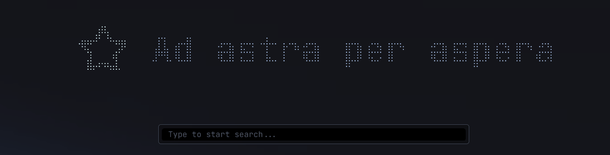
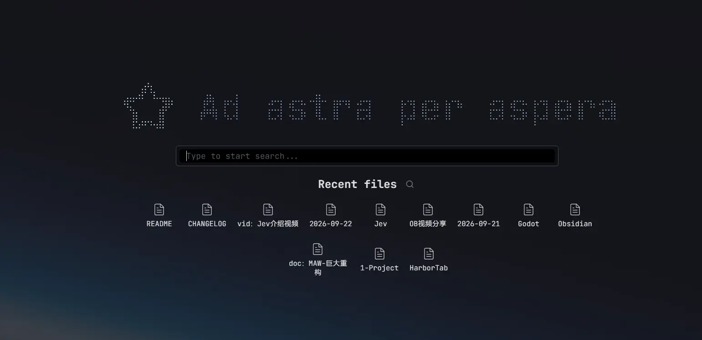
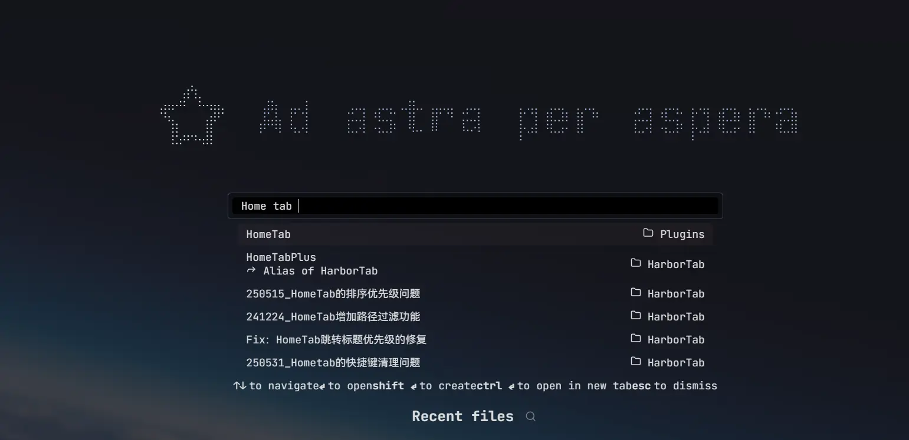
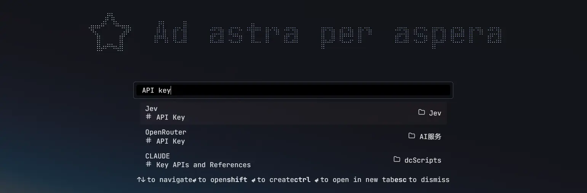
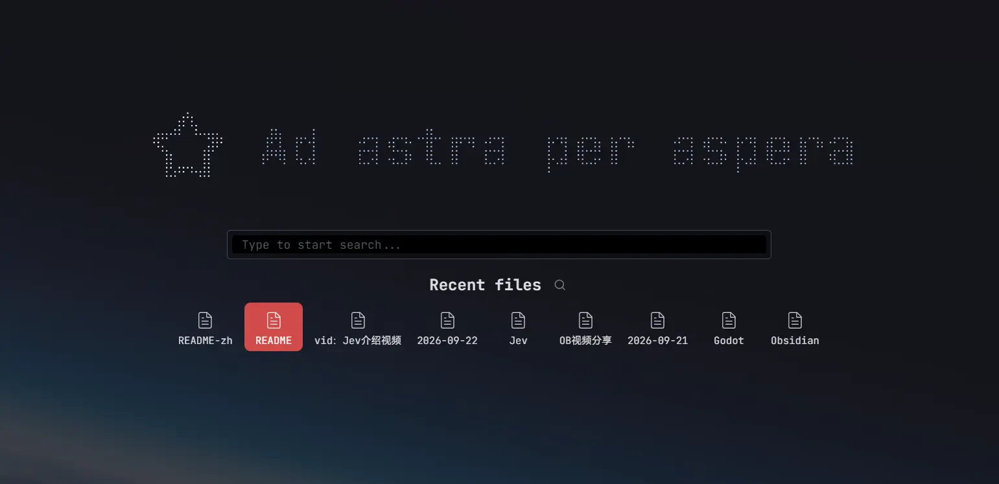
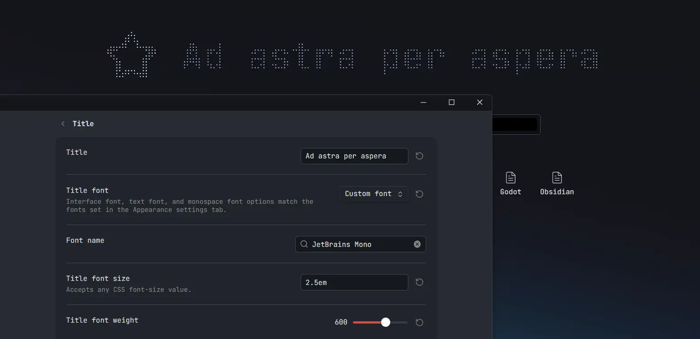
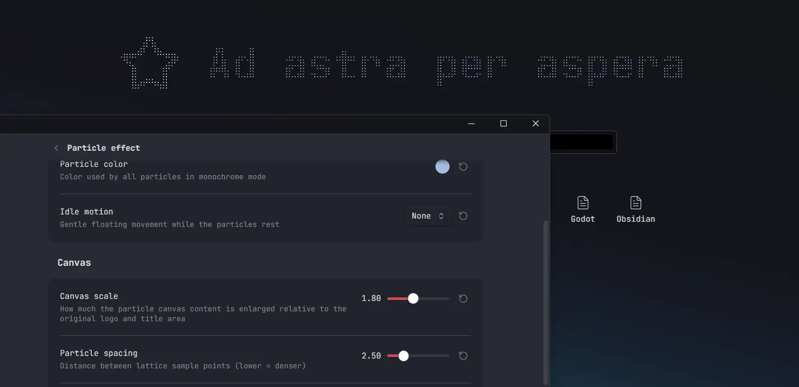
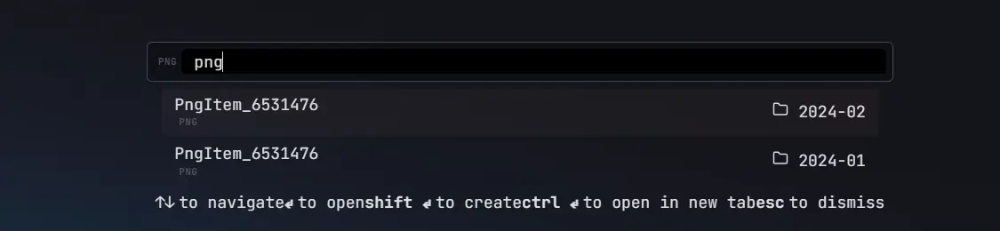
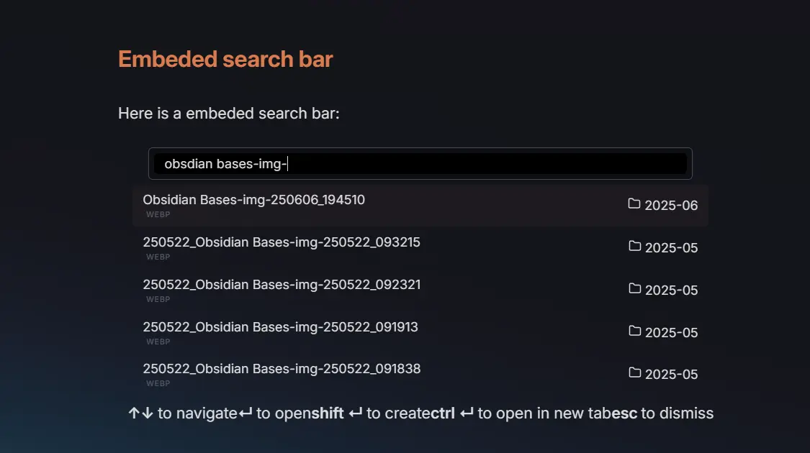

*通向每条笔记的港口。*

# Harbor Tab

[](https://obsidian.md/plugins?id=harbor-tab) [](https://github.com/Moyf/harbor-tab/releases) [](https://github.com/Moyf/harbor-tab/issues) [](https://github.com/Moyf/harbor-tab/stargazers)

中文文档 | [English](https://github.com/Moyf/harbor-tab/blob/main/README.md)

Harbor Tab 是一款 [Obsidian](https://obsidian.md/) 插件，为默认新标签页提供类似浏览器的首页体验，包含搜索栏、最近打开笔记、收藏笔记等。


> 继承自 [olrenso](https://github.com/olrenso) 的 [Home tab](https://github.com/olrenso/Obsidian-home-tab) 插件，在此基础上持续更新并加入新特性。

## 使用方法
启用插件后，每个新的空标签页都会自动替换为 Harbor Tab 视图。
你可以在设置中关闭该行为，并通过命令面板使用 `Harbor Tab: Open new tab` 或 `Harbor Tab: Replace current tab` 命令手动打开新的 Harbor Tab。

## 特性介绍
### 快速搜索
你可以在仓库中搜索任何本地文件，包括 Markdown 笔记和附件。



*打开新标签，键入笔记名，回车前往——就像在港口中登上一艘艘不同的「笔记之船」。*

值得一提的是——
**除了搜索笔记名之外，插件还支持搜索 title 属性或者任意笔记标题**。



选择后可以跳转到对应标题的位置。

### 最近笔记
搜索栏的下方还会显示最近查看过的笔记，方便快速恢复。



同样可以将收藏笔记（Bookmark）显示在下方，快速跳转。

### 自定义 LOGO 和标题
搜索框上方的图标和文本均支持自定义：


支持启用粒子效果，使它成为可与鼠标交互的酷炫颗粒：


### 新增内容
相比原版 Home tab，本 fork 持续开发了以下功能：

- **标题搜索与跳转** — 搜索文档中的标题并自动跳转到匹配位置，采用智能跳转策略
- **网页链接建议** — 检测搜索栏中输入的网址，并提示用 Web Viewer 核心插件打开
- **多语言** — 支持英文和简体中文
- **粒子字标** — 将 Logo 和标题渲染为可交互的粒子网格，鼠标靠近时产生涟漪效果
- **现代化的设置页** — 基于 Obsidian 声明式设置 API 重建，组织为多个子页面

## 功能特性
### 按文件类型或扩展名筛选搜索
为了更快找到文件，你可以使用文件类型或扩展名筛选器来过滤搜索结果。

输入筛选键（见下表）并按下 Tab 即可激活筛选器；按退格键可移除筛选器。



#### 筛选键
可用的筛选器如下：

| 文件类型 | 文件扩展名 |
| :-: | :-: |
| `markdown` | `md` |
| `image` | `png `、` jpg `、` jpeg `、` svg `、` gif `、` bmp` |
| `video` | `mp4 `、` webm `、` ogv `、` mov `、` mkv` |
| `audio` | `mp3 `、` wav `、` m4a `、` ogg `、` 3gp `、` flac` |
| `pdf` | `pdf` |
| `canvas` | `canvas` |

### 显示与搜索样式

在 **显示内容 → 显示** 中，可以拖拽调整周期笔记、最近文件、书签的顺序，设置区块折叠，或启用 **Compact 模式**，让所有宽度下的文件列表都使用左侧小图标、右侧单行文件名。紧凑项目居中横向排列，一行可显示多个，并自动换行。默认顺序为「周期笔记 → 最近文件 → 书签」，键盘导航也会跟随所选顺序。

**使用属性作为名称** 默认填入 `title`。可以填写 `title, aliases` 等用英文逗号分隔的属性名，依次回退；列表取第一个值，都没有时使用原始文件名。允许留空，直接使用文件名。周期笔记的自定义显示文字仍优先，「文件名」模式则跟随通用设置。

**文件列表排列** 默认使用 **居中排列**。选择 **网格对齐** 可让最近文件和书签按等宽列对齐，最多四列，窄屏自动减少列数，支持开启或关闭 Compact 模式。

在 **搜索 → 样式** 中，可以选择 **Modern**（默认，圆角半透明输入框，带较厚的半透明外圈）、**Classic**（原有外观）、**Transparent**（尺寸适中，无背景、无边框、无模糊）或 **Minimal**（更小的 Classic 变体，直角、无边框、更少间距与更小字号）。新建按钮仍位于输入框旁；**周期笔记** 子页面内的每个周期也有独立设置组。

粒子设置分为 **颜色、效果、画布、交互** 四组。**基础颜色** 与 **渐变颜色** 搭配，渐变颜色占比默认 15%（10%–90%），过渡范围默认 30%（0%–100%），两项空间参数适用于静态和循环渐变。间距为 1–3、步长 0.1，大小为 0.2–1、步长 0.05，「自适应粒子大小」可保留颗粒间隙并缩小边缘颗粒，保持 Logo 和标题轮廓。

**自适应粒子大小** 默认关闭，颗粒使用统一半径；开启后保留颗粒间隙并缩小边缘颗粒，缩放前半径最小为 0.2。空间渐变按 Logo 和标题实际粒子的范围定位，不包含画布留白：静态渐变的第二种颜色位于所选角度方向的一端（90° 向右、180° 向下），循环渐变色带则在该范围内移动。页面留白位于缩放画布外，Logo 和标题的 margin 仍用于调整位置。

**画布上下留白** 分别设置，默认上方 40px、下方 0px（每侧 0–150px、步长 5），不随画布倍率缩放。已有的统一留白值会保留到上下两项。设置页预览会随画布增高，包含这些空间。

新安装默认使用循环渐变粒子与波浪运动，间距 1.3、大小 0.45；标题使用库的文本字体，字号 3.5em；Compact 默认开启并采用居中排列。库统计默认显示，周期笔记仍默认关闭，自定义图片来源默认为空。

**保留原始明暗** 默认开启，单色和渐变模式均保留图片及 SVG 的明暗变化；关闭后直接使用所选颜色。循环停歇时保持基础颜色，开启该选项时也保留其明暗。

内置的新旧 Obsidian Logo 仅在开启粒子、使用单色或渐变且关闭「保留原始明暗」时使用切面分离 SVG；开启明暗保留时使用原版 Logo，采样其原有明暗层次。

**Logo 缩放** 独立控制 Logo 大小；标题字号只改变标题，不再联动内置图标、Lucide 图标、图片或粘贴的 SVG。

**停歇间隔** 在循环渐变和呼吸灯的「动画频率」下方显示（0–10 秒、步长 0.25、默认 0）。启用停歇后，循环渐变色带完整扫过粒子，再停留在纯基础颜色；呼吸灯在每个颜色停留后再过渡到另一个颜色。频率只改变动画速度，停歇始终保持设定的秒数；0 表示连续变化。

在 **Logo → 图标** 中选择 **SVG 代码**，即可在多行输入框直接粘贴完整 SVG。有效代码会更新 Logo，无效代码会提示并保留之前的图像；清空输入框则移除图像。粘贴的 SVG 同样支持粒子效果。

**辉光** 默认关闭，开启后显示「辉光强度」（0–100，默认 40）。它提亮粒子核心并添加半透明外部光晕，在大画布上的绘制开销较大。

### 粒子交互

**鼠标视差** 默认关闭，开启后在整个 Obsidian 窗口内检测鼠标，反向平移并加入 3D 倾斜，离开后平滑归位。仅桌面生效，并尊重减少动态效果偏好。

在 **粒子效果 → 交互** 中，**扰动半径**范围为 5–100 px（默认 40），扰动强度默认 1。**扰动衰减**（0.1–2.0、步长 0.1）控制鼠标和触屏扰动在半径外的衰减，默认 0.8；恢复速度默认 1.5。**阻尼系数**（0–100、默认 60）独立于恢复速度控制回弹；数值越高，恢复越平稳。

### 嵌入式搜索栏

**搜索 → 下拉列表显示** 默认使用 **叠加覆盖**，覆盖下方内容且不改变页面高度。独立标签页与嵌入块均生效，列表可以显示到 block 范围外。**拓展高度** 保留原有的内联布局。非空查询无匹配时显示 **无匹配结果**，清空输入则隐藏列表。
你可以将 Harbor Tab 视图嵌入任意笔记，可选择显示最近文件、星标文件，或只显示搜索栏。

要将搜索栏嵌入笔记，需要创建一个 `search-bar` 代码块（见下方示例）。

只显示搜索栏（不显示标题和 Logo/图标）：在新的一行添加 `only search bar`。
显示星标文件和最近文件：分别添加 `show starred files` 和 `show recent files`。
周期笔记（需在设置中开启）可通过 `show periodic notes` 显示。

例如，以下代码块会渲染出搜索栏和星标文件：

````text
```search-bar
only search bar
show starred files
```
````



---

## 安装方法
插件将上架 [Obsidian 插件市场](https://obsidian.md/plugins?id=harbor-tab)，可直接安装。

你也可以通过 [BRAT](https://github.com/TfTHacker/obsidian42-brat) 安装，使用以下链接：`https://github.com/Moyf/harbor-tab` 或 `Moyf/harbor-tab`。

---

## 致谢

- 原版 [Home tab](https://github.com/olrenso/Obsidian-home-tab) 插件，作者 [olrenso](https://github.com/olrenso) ❤️
- 持续开发已获得原作者许可 —— 详见 [olrenso/obsidian-home-tab#65](https://github.com/olrenso/obsidian-home-tab/issues/65)
- 粒子字标效果灵感来自 [BlackCoder0](https://github.com/BlackCoder0) 的 [Arknights-FlowingPoints](https://github.com/BlackCoder0/Arknights-FlowingPoints) —— 我们的实现是对该创意的独立重写
- 背景图片使用 [style context](https://github.com/Moyf/style-context) 插件实现

## 支持作者

如果 Harbor Tab 对你有帮助，欢迎[请我喝杯咖啡（Ko-fi）](https://ko-fi.com/moy) ☕

## 来自 Moy 的更多插件

如果你欣赏我的插件设计和质量，可以看看我的其他 Obsidian 插件：

| 插件 | 简介 | 数据 |
| --- | --- | --- |
| [Yearly Glance](https://github.com/Moyf/yearly-glance) | 年度一览，一眼纵览你全年的关键事件。 |   |
| [Easy Copy](https://github.com/Moyf/easy-copy) | 轻松复制格式文本，或生成优雅的标题链接。 |   |
| [Better Links](https://github.com/Moyf/better-links) | 你绝对需要的链接编辑体验提升插件。 |   |
| [Style Context](https://github.com/Moyf/style-context) | 将你的 Obsidian 背景换成任意库内图片！ |   |
| [Colorful Highlights](https://github.com/Moyf/colorful-highlights) | 彩色高亮效果增强，提供多种样式，或自定义新配色。 |   |
| [Single Choice Property](https://github.com/Moyf/single-choice-property) | 让选定的列表属性始终只保留一个值。 |   |

全部插件见 [Moy 的 Obsidian Community 页面](https://community.obsidian.md/users/moyf)。

参与开发的友情插件：[Note Toolbar](https://github.com/chrisgurney/obsidian-note-toolbar) & [Typify](https://github.com/leike-dev/Obsidian-Typify) ❤️
